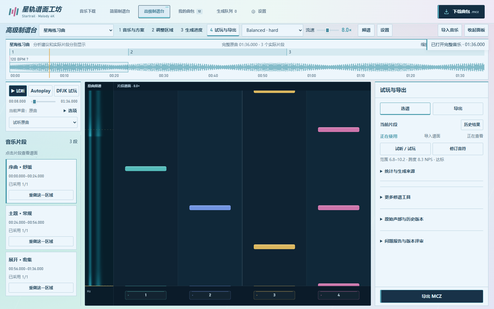
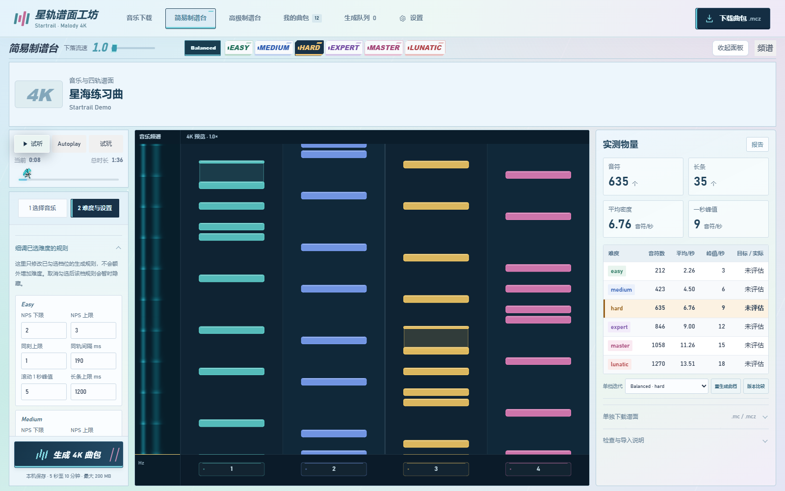
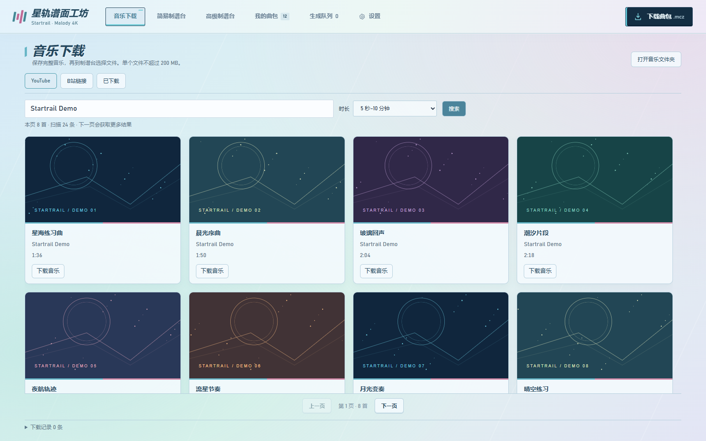
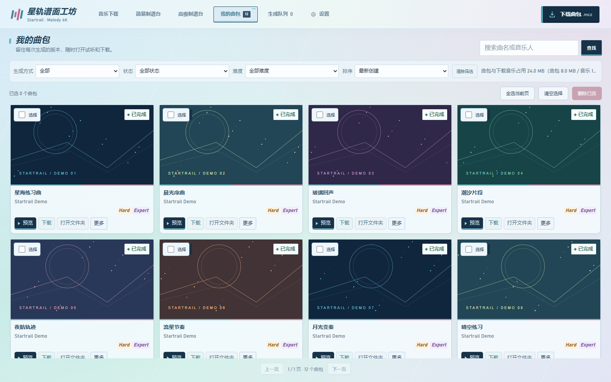
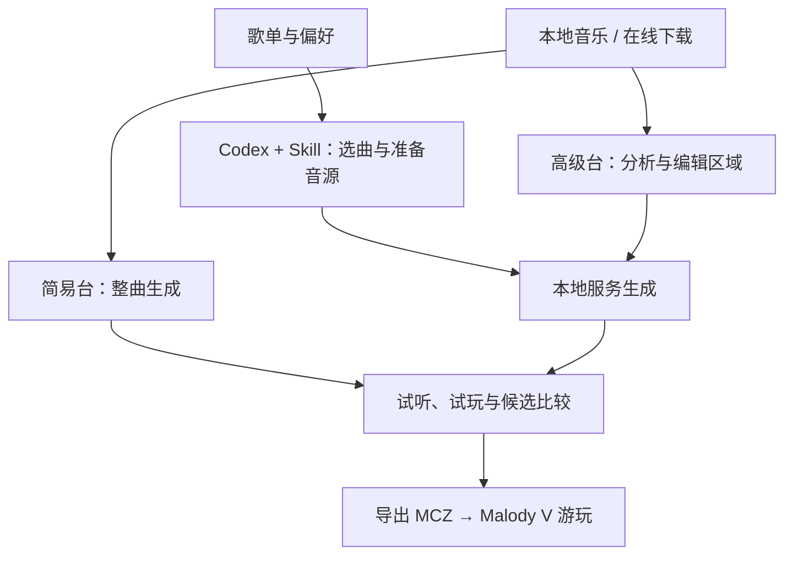

# 星轨谱面工坊 · Startrail

<div align="center">
  
  <h1>STARTRAIL · MALODY CHART FORGE</h1>
  <p><strong>从歌单到四轨：用 Codex 安排自动制谱，本地生成，网页试听与精修。</strong><br>Let Codex arrange playlist tasks; generate locally, review and refine in the studio.</p>
  <p>
    
    
    
  </p>
  <p><a href="#简体中文">简体中文</a> · <a href="#english">English</a> · <a href="#快速开始">快速开始</a> · <a href="demos/README.md">可玩 Demo + 视频</a> · <a href="docs/codex-workflow.md">Codex 歌单任务</a> · <a href="CHANGELOG.md">Release notes</a> · <a href="https://github.com/DokiDokiYuyuko/Malody-Chart-Forge/tree/v1">v1 archive</a></p>
</div>



| 简易制谱台 · Simple studio | 音乐下载 · Music downloads |
| --- | --- |
|  |  |



界面截图使用示例数据。 Screenshots use sample data.

<a id="简体中文"></a>
## 简体中文

Startrail 是面向 **Windows 电脑端、经典 Malody 4K** 的本地制谱工具。简易台适合整曲生成；高级台支持音轨准备、区域规划、局部重做、A/B 候选和曲包导出。

**多首或歌单制谱，推荐让 Codex 使用本仓库的 Skill 安排自动任务。** 提供网易云歌单、音乐人偏好、曲目数量和难度目标，由 Codex 选曲、准备音源、提交本地任务并整理成品。网页用于单曲制谱、试听试玩、区域编辑和候选比较。

### 先玩一下：六首 Demo，Expert / Master 都有

每个 MCZ 包含完整音轨、封面和 Expert / Master 两张谱面，下载后即可导入 Malody V 游玩。

| 曲目 | Expert / Master 平均 NPS | 下载 |
| --- | --- | --- |
| 玩具 · V.W.P | 11.11 / 13.66 | [MCZ](demos/toy-vwp.mcz) |
| INTERNET YAMERO (cover) · ヰ世界情緒 | 12.13 / 14.24 | [MCZ](demos/internet-yamero-isekaijoucho.mcz) |
| アンノウン・マザーグース - covered by ヰ世界情緒 · ヰ世界情緒 | 9.78 / 13.57 | [MCZ](demos/unknown-mother-goose-isekaijoucho.mcz) |
| 裏表ラバーズ · wowaka / 初音ミク | 11.49 / 14.95 | [MCZ](demos/ura-omote-lovers.mcz) |
| 魔女(真) sinka ver. · V.W.P | 10.42 / 12.13 | [MCZ](demos/witch-shin-vwp.mcz) |
| Night of Bloom (feat. nayuta) · Kirara Magic / Xomu / nayuta | 11.07 / 13.47 | [MCZ](demos/night-of-bloom.mcz) |

**每首 30 秒，×3 流速、60 FPS，Expert / Master 并排展示。** 播放器支持直接在线播放；点击音量按钮可听到原曲和 Malody V `hit-4` 按键音。

<table>
<tr>
<td width="50%">
<strong>玩具</strong><br>
V.W.P

https://github.com/user-attachments/assets/9520455c-f757-42c6-865c-273f8a9241b1

<a href="demos/toy-vwp.mcz">下载 MCZ · Expert / Master</a>
</td>
<td width="50%">
<strong>INTERNET YAMERO (cover)</strong><br>
ヰ世界情緒

https://github.com/user-attachments/assets/50ba83da-e8f2-490c-96c8-13861471c37b

<a href="demos/internet-yamero-isekaijoucho.mcz">下载 MCZ · Expert / Master</a>
</td>
</tr>
<tr>
<td width="50%">
<strong>アンノウン・マザーグース - covered by ヰ世界情緒</strong><br>
ヰ世界情緒

https://github.com/user-attachments/assets/32a8160d-af89-48f1-a44e-1ad381505d13

<a href="demos/unknown-mother-goose-isekaijoucho.mcz">下载 MCZ · Expert / Master</a>
</td>
<td width="50%">
<strong>裏表ラバーズ</strong><br>
wowaka / 初音ミク

https://github.com/user-attachments/assets/129a40b5-c9b1-4cbd-93a3-33b171e72c47

<a href="demos/ura-omote-lovers.mcz">下载 MCZ · Expert / Master</a>
</td>
</tr>
<tr>
<td width="50%">
<strong>魔女(真) sinka ver.</strong><br>
V.W.P

https://github.com/user-attachments/assets/98e91443-50df-4b44-951d-58f0f7687e45

<a href="demos/witch-shin-vwp.mcz">下载 MCZ · Expert / Master</a>
</td>
<td width="50%">
<strong>Night of Bloom (feat. nayuta)</strong><br>
Kirara Magic / Xomu / nayuta

https://github.com/user-attachments/assets/4054134b-8caf-489e-8a8d-89d48285ba7e

<a href="demos/night-of-bloom.mcz">下载 MCZ · Expert / Master</a>
</td>
</tr>
</table>

视频由谱面数据渲染。完整曲包和导入步骤见 [Demo 文件夹](demos/README.md)。

### 快速开始

需要 **Windows 10/11 x64、Python 3.12 x64 和 Git for Windows**。V32 需要支持 CUDA 13.0 的 NVIDIA GPU 与驱动。模型与环境需要数十 GB 存储空间。

```powershell
git clone --recurse-submodules https://github.com/DokiDokiYuyuko/Malody-Chart-Forge.git
cd Malody-Chart-Forge
```

1. 双击 **`一键配置环境.bat`**，选择 MuG、V32 或两者，按提示完成依赖安装和模型下载。
2. 使用 V32 或高级台时，安装 Beat This 分析环境：

   ```powershell
   .\.venv\Scripts\python.exe tools\setup_beat_analysis.py
   ```

3. 双击 **`启动制谱台.bat`**，打开本机网页，默认地址为 `http://127.0.0.1:8765`。

启动问题可查看 `logs/server.stderr.log`。手动安装、模型版本、可选声部分离与 YouTube 登录设置见 [安装与模型说明](models/README.md)。

更新已有安装：保存本地修改，更新 `main` 后运行 `git submodule update --init --recursive`。旧版源码见 [`v1`](https://github.com/DokiDokiYuyuko/Malody-Chart-Forge/tree/v1)。

### 推荐：让 Codex 根据歌单安排任务

启动制谱服务，在 Codex 中打开本项目，提交类似任务：

```text
读取 skills/malody-4k/SKILL.md，使用已运行的本地制谱服务。
从这个网易云歌单挑选 20 首：<歌单链接>，优先 <音乐人>，与已有成品去重。
生成键盘 4K Expert / Master，目标 NPS 分别为 9–12 / 11–15。
每首最多尝试 3 个候选，核对完整录音、封面和作者。
完成后检查谱面，整理选定的 MCZ 曲包和结果汇总。
```

数量、难度和尝试次数可按偏好调整。歌单用于选曲，音源可使用本地文件或经过核验的在线录音。需要导入游戏时，补充 Malody V 的 `chart` 目录。

详见 [Codex 歌单工作流](docs/codex-workflow.md) 和 [制谱 Skill](skills/malody-4k/SKILL.md)。

### 功能

| 工作区 | 可以做什么 |
| --- | --- |
| 音乐下载 | 搜索 YouTube、解析 B站链接，确认曲名和音乐人后保存音轨。 |
| 简易制谱台 | 选择本地音乐、排键和难度，整曲生成后试听、Autoplay、DFJK 试玩及导出。 |
| 高级制谱台 | 分析音轨、试听与编辑区域、调整强弱，按区域生成或重做谱面。 |
| 分离与比较 | Demucs 快速分离、Kim Mel-Band RoFormer 质量档，人声／伴奏输入与同位置 A/B 试听。 |
| 候选与历史 | 保存生成版本，比较局部重做结果，选择采用新版或保留原版。 |
| 曲包库与队列 | 搜索、预览、下载、打开文件夹及多选删除，查看任务进度和历史。 |
| 试听与试玩 | 波形、频谱与四轨同步播放，支持跳转、暂停、重试与结算。 |
| 外观与署名 | 五套主题、鼠标流星开关和谱师署名设置。 |
| 可选 Agent 修谱 | 连接自己的修谱／听音 API，比较建议的修订后选择采用。 |

### 使用流程



**简易台：** 选择音乐，确认曲名、音乐人和谱师，设置排键与难度。V32 支持为每档填写 NPS 范围。生成后切换难度试听或试玩，再导出曲包。

**高级台：** 导入音频或 MCZ，选择难度和音源，点击「开始处理」。试听区域方案，调整边界、合并区域或改变强弱，再点击「确认方案并生成」。局部重做后可同位置比较 A/B，并选择采用的版本。

成品保存在 `outputs/曲包/`，可在曲包库中预览、下载和管理。服务重启后，暂停的任务可在队列中继续。生成后建议试听和试玩，并按手感调整难度与区域。

### 文件与联网

原曲、谱面版本和成品保存在本机，临时文件自动清理；排查单曲问题时可开启「保留调试文件」。详见 [存储说明](docs/storage.md)。

制谱模型在本地运行。在线搜索与下载连接对应音乐平台；启用 Agent 评审时，会向所配置的服务发送评审片段，音频发送可单独开关。提供给 Codex 的任务和工具结果按 Codex 的配置处理。

### 开发与技术文档

- [谱面指标、生成条件与导入工具](docs/chart-quality.md)
- [批量提交与服务接口](skills/malody-4k/references/service-api.md)
- [模型版本、依赖与安装](models/README.md)

```powershell
.\.venv\Scripts\python.exe -m pytest -q
node --test tests/*.cjs tests/*.js
```

部分集成测试需要浏览器或模型环境。

### 来源与许可

本项目为独立社区工具。模型与组件使用各自的上游许可：

- [MuG Diffusion](https://github.com/Keytoyze/Mug-Diffusion) / [模型权重](https://huggingface.co/ayousanz/Mug-Diffusion-model)：非商业使用，分享生成谱面时保留 AI 来源说明。
- [Mapperatorinator](https://github.com/OliBomby/Mapperatorinator) / [V32](https://huggingface.co/OliBomby/Mapperatorinator-v32/tree/74f22583400d259bf424819e11027c17933efe54)：代码与模型条款见上游 MIT 文件和模型卡。
- [Beat This](https://github.com/CPJKU/beat_this)、[Demucs](https://github.com/facebookresearch/demucs)、[RoFormer 推理来源](https://github.com/ZFTurbo/Music-Source-Separation-Training)：许可与权重条款见各自项目。

音乐、封面与输入谱面的权利归其权利人所有。应用整体尚未指定许可证。

---

<a id="english"></a>
## English

**Startrail · Malody Chart Forge** generates classic Malody 4K charts locally on Windows. The Simple studio handles whole songs; the Advanced studio supports region planning, stems, local regeneration and A/B review.

**For playlists, we recommend asking Codex to use the repository's Skill.** Give it the playlist, artist preferences, song count and difficulty goals. Codex prepares sources, submits local tasks and organizes the resulting packages. Use the web studio for individual songs, listening, practice and editing.

### Demos

[Six playable MCZs](demos/README.md) include full audio, artwork and Expert / Master charts. The players above show 30-second chart-data renders at ×3 scroll speed and 60 FPS, with Malody V `hit-4` sound. Unmute a player to hear the music and key sounds, or download a package to play in Malody V.

### Install and start

Use Windows 10/11 x64, Python 3.12 x64 and Git for Windows. V32 requires an NVIDIA GPU and a CUDA 13.0-compatible driver. Reserve tens of GB for models and environments.

1. Clone this repository with `--recurse-submodules`.
2. Run **`一键配置环境.bat`** and select MuG, V32 or both.
3. For V32 or the Advanced studio, run `.\.venv\Scripts\python.exe tools\setup_beat_analysis.py`.
4. Run **`启动制谱台.bat`**. The default studio URL is `http://127.0.0.1:8765`.

See [model setup](models/README.md) for manual installation, optional separation and YouTube login. Startup errors are logged in `logs/server.stderr.log`. After updating an existing checkout, run `git submodule update --init --recursive`. The earlier version is available on [`v1`](https://github.com/DokiDokiYuyuko/Malody-Chart-Forge/tree/v1).

### Playlist tasks and authoring

Start the local service and open this project in Codex. Ask it to read `skills/malody-4k/SKILL.md`, then provide a playlist, artist preferences, song count, difficulty/NPS goals and attempt budget. Include your Malody V `chart` directory if you want the packages imported. See the [workflow and task template](docs/codex-workflow.md).

In the Simple studio, select music and difficulties, generate, then listen or practice before export. In the Advanced studio, import audio or MCZ, click **Start processing**, edit the suggested regions and choose **Confirm plan and generate**. Compare local revisions with A/B and select the versions to export.

Both studios include synchronized waveform, spectrum and four-lane previews, Autoplay, DFJK practice, configurable chart-author credits and five themes. The library provides search, previews, downloads and multiple deletion. Finished packages are saved under `outputs/曲包/`.

### Files and network access

Original music, chart versions and packages are saved locally; temporary files are cleaned automatically. Enable debug retention when investigating a song. See [storage](docs/storage.md).

Chart models run locally. Online searches and downloads connect to the selected platforms. Optional Agent review sends excerpts to your configured service, with a separate audio switch. Tasks and tool results supplied to Codex follow its configuration.

### Technical documentation and sources

See [quality and import](docs/chart-quality.md), [service APIs](skills/malody-4k/references/service-api.md) and [model setup](models/README.md). Run tests with `.\.venv\Scripts\python.exe -m pytest -q` and `node --test tests/*.cjs tests/*.js`; some integration tests require browser or model environments.

Component licenses and model terms are linked in the source list above. MuG weights and generated charts are for non-commercial use; retain AI provenance when sharing charts. Music and artwork rights belong to their owners. The application as a whole has no designated license.
