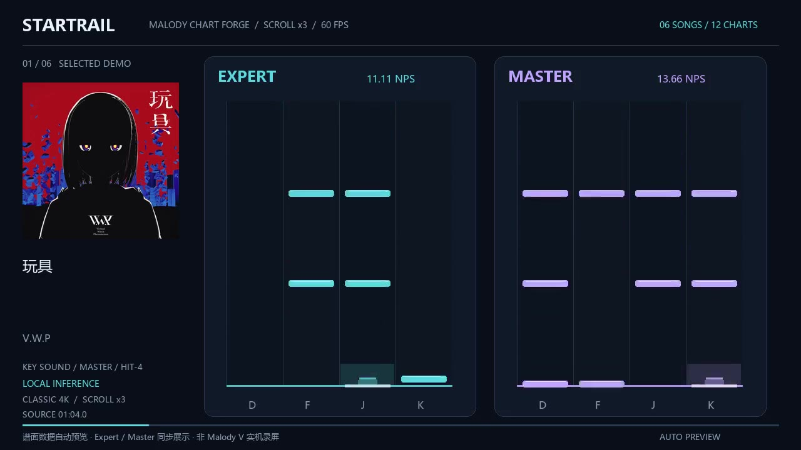
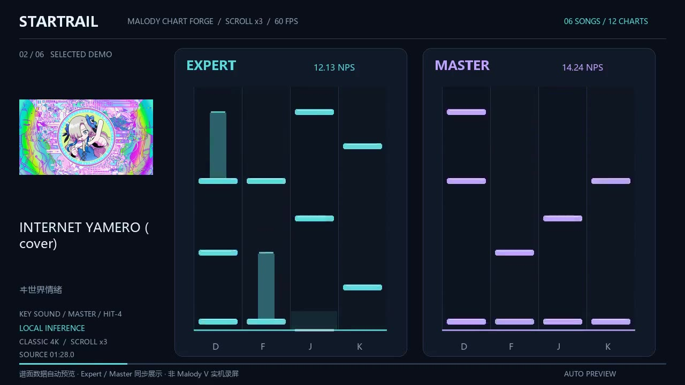
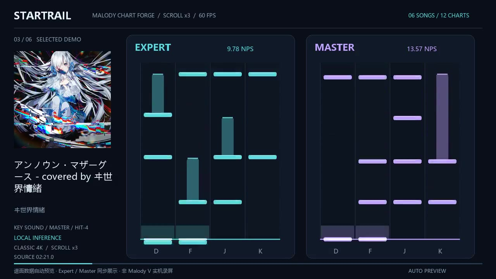
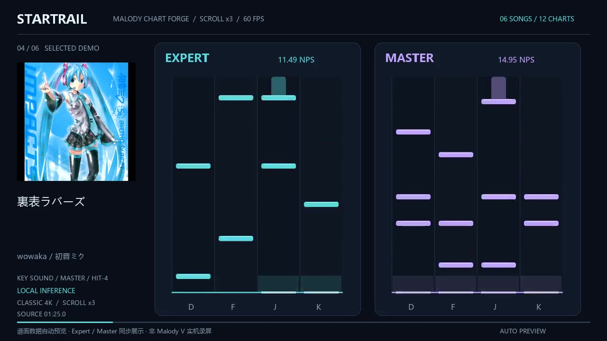
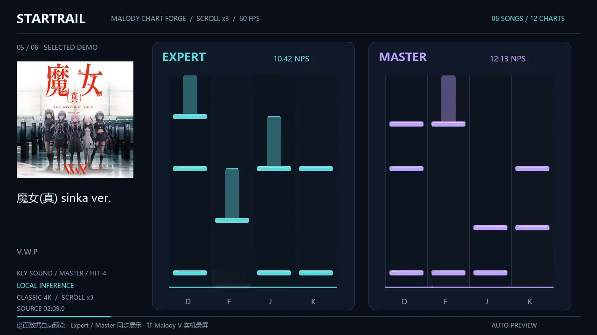
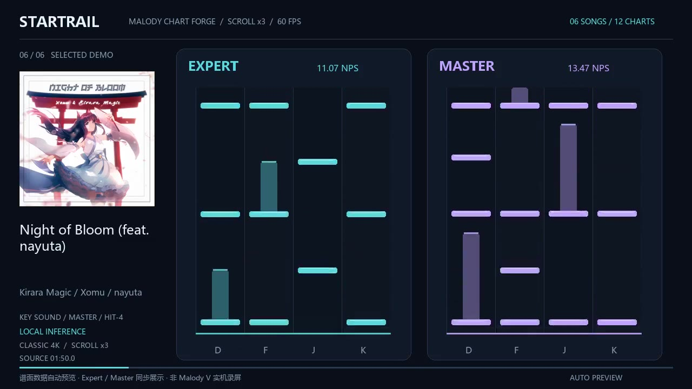

# 可直接游玩的示例 · Playable demos

六首歌曲，每个 MCZ 都包含完整音轨、对应封面和 **Balanced Expert / Master** 两张经典 Malody 4K 谱面，共 12 张。它们来自已导入 Malody V 的成品；本次重新核对了包内容与游戏目录文件字节一致。

| 曲目／录音版本 | 音乐人 | Expert 平均 NPS | Master 平均 NPS | 曲包 |
| --- | --- | ---: | ---: | --- |
| 玩具 | V.W.P | 11.11 | 13.66 | [下载 MCZ](toy-vwp.mcz) |
| INTERNET YAMERO (cover) | ヰ世界情緒 | 12.13 | 14.24 | [下载 MCZ](internet-yamero-isekaijoucho.mcz) |
| アンノウン・マザーグース - covered by ヰ世界情緒 | ヰ世界情緒 | 9.78 | 13.57 | [下载 MCZ](unknown-mother-goose-isekaijoucho.mcz) |
| 裏表ラバーズ | wowaka / 初音ミク | 11.49 | 14.95 | [下载 MCZ](ura-omote-lovers.mcz) |
| 魔女(真) sinka ver. | V.W.P | 10.42 | 12.13 | [下载 MCZ](witch-shin-vwp.mcz) |
| Night of Bloom (feat. nayuta) | Kirara Magic / Xomu / nayuta | 11.07 | 13.47 | [下载 MCZ](night-of-bloom.mcz) |

点击曲包链接后使用 GitHub 的 **Raw / Download raw file** 下载 MCZ，将其导入电脑端 Malody / Malody V，再选择 Expert 或 Master。无需安装本制谱器、模型或 Codex 即可游玩这些成品。已有导入工具也可以使用 [显式选包导入](../docs/chart-quality.md)。

平均 NPS 根据可击打跨度计算，具体定义见 [质量说明](../docs/chart-quality.md)。这些曲包来自不同批次，不是统一参数对照实验；数值不是官方等级或真人手感评分。目录回读记录也不代表每张谱面都经过本次真人试玩。

## 逐曲视频 · 每首 30 秒

1280×720 / 60 FPS / ×3 流速 / H.264 + AAC。每首保留一段连续 30 秒的音乐，Expert 与 Master 按包内真实音符数据、同一录音时钟并排展示。按键音采用 Malody V 内置 `hit-4`，只跟随 Master 音符头触发，长按不重复。

<table>
  <tr>
    <td width="50%">
      <strong>玩具</strong> 
      V.W.P 
       
      <a href="https://github.com/DokiDokiYuyuko/Malody-Chart-Forge/raw/refs/heads/main/demos/videos/toy-vwp.mp4">▶ 播放 30 秒</a> · <a href="toy-vwp.mcz">下载 MCZ</a>
    </td>
    <td width="50%">
      <strong>INTERNET YAMERO (cover)</strong> 
      ヰ世界情緒 
       
      <a href="https://github.com/DokiDokiYuyuko/Malody-Chart-Forge/raw/refs/heads/main/demos/videos/internet-yamero-isekaijoucho.mp4">▶ 播放 30 秒</a> · <a href="internet-yamero-isekaijoucho.mcz">下载 MCZ</a>
    </td>
  </tr>
  <tr>
    <td width="50%">
      <strong>アンノウン・マザーグース - covered by ヰ世界情緒</strong> 
      ヰ世界情緒 
       
      <a href="https://github.com/DokiDokiYuyuko/Malody-Chart-Forge/raw/refs/heads/main/demos/videos/unknown-mother-goose-isekaijoucho.mp4">▶ 播放 30 秒</a> · <a href="unknown-mother-goose-isekaijoucho.mcz">下载 MCZ</a>
    </td>
    <td width="50%">
      <strong>裏表ラバーズ</strong> 
      wowaka / 初音ミク 
       
      <a href="https://github.com/DokiDokiYuyuko/Malody-Chart-Forge/raw/refs/heads/main/demos/videos/ura-omote-lovers.mp4">▶ 播放 30 秒</a> · <a href="ura-omote-lovers.mcz">下载 MCZ</a>
    </td>
  </tr>
  <tr>
    <td width="50%">
      <strong>魔女(真) sinka ver.</strong> 
      V.W.P 
       
      <a href="https://github.com/DokiDokiYuyuko/Malody-Chart-Forge/raw/refs/heads/main/demos/videos/witch-shin-vwp.mp4">▶ 播放 30 秒</a> · <a href="witch-shin-vwp.mcz">下载 MCZ</a>
    </td>
    <td width="50%">
      <strong>Night of Bloom (feat. nayuta)</strong> 
      Kirara Magic / Xomu / nayuta 
       
      <a href="https://github.com/DokiDokiYuyuko/Malody-Chart-Forge/raw/refs/heads/main/demos/videos/night-of-bloom.mp4">▶ 播放 30 秒</a> · <a href="night-of-bloom.mcz">下载 MCZ</a>
    </td>
  </tr>
</table>

点击缩略图或“播放 30 秒”打开对应 MP4。只改变滚动速度，不加速音频或改变音符时间。**这是谱面数据自动渲染，非 Malody V 实机录屏。** 视频展示片段，完整游玩请下载曲包。

[manifest.json](manifest.json) 列出曲包与音频哈希、录音元数据、每档音符／长按数量、密度和视频片段时间，便于核验下载结果。源文件保留 AI 制谱署名 `Startrail`。音乐和封面仍归原权利人，示例的提供不授予这些素材的转载或商业使用权。

## English

Six ready-to-import MCZs contain full audio, cover art and both **Balanced Expert and Master** charts for classic Malody 4K. No chart-generation environment or Codex installation is required to play them. Open a package link, download the raw file, import it into desktop Malody / Malody V and choose a difficulty.

The packages match the previously installed game files byte-for-byte. Their active-span NPS values are listed above; they are not official levels or human-playtest scores. The [manifest](manifest.json) includes hashes, metadata and per-chart metrics. These examples come from different production batches.

The gallery links to six individual 30-second videos at 60 FPS and ×3 scroll speed. Each shows a continuous excerpt with actual Expert/Master chart data synchronized to the recording; Malody V built-in `hit-4` sound follows Master note heads. Audio speed and note timing are unchanged. **These are chart-data renders, not Malody V gameplay recordings.** Original music/artwork rights remain with their owners; inclusion does not grant redistribution or commercial-use rights.
