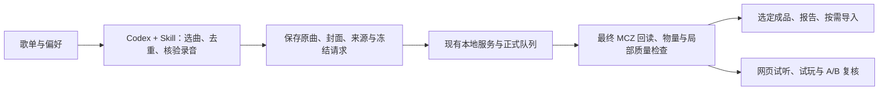

# 用 Codex 按歌单安排自动制谱 · Playlist tasks with Codex

**批量制谱更推荐交给 Codex，结合本仓库的 `malody-4k` Skill 执行。** 把歌单链接、喜欢的音乐人、数量和难度告诉 Codex，它可以筛选歌曲、核验录音、准备完整音源、提交本地任务并检查交付。比逐首在前端上传、设置和提交更方便。网页继续用于单曲操作、试听试玩、区域编辑和候选 A/B。

Skill 指导 Codex 调用本地制谱服务，组织选曲、生成和交付步骤。

## 开始前

1. 按 [README](../README.md#快速开始) 安装所需引擎和 Beat This，并启动本地制谱服务。
2. 在 Codex 中打开本项目，让它先读取 [`skills/malody-4k/SKILL.md`](../skills/malody-4k/SKILL.md)。可以直接使用下面的任务文本，无需先安装全局 Skill。
3. 提供歌单链接或本地曲目清单，以及数量、音乐人偏好、难度、密度目标、尝试预算和是否导入游戏。音源需要对应完整、准确的录音版本。

网易云歌单用于选曲和获取元数据；完整音源可使用本地文件或经过核验的在线录音。无法取得的曲目会列入待处理清单。

## 可复制的任务示例

```text
先读取 skills/malody-4k/SKILL.md，使用已经运行的本地制谱服务。

根据以下网易云歌单挑选 20 首，优先我指定的音乐人，并与已有成品去重：
<歌单链接与音乐人偏好>

使用高级制谱流程和 V32，生成键盘 4K Balanced Expert / Master。
Expert 平均 NPS 目标 9–12，Master 11–15；希望 Master 至少高 1 NPS，
同时检查活动段、短时峰值和单轨负担。
每首最多 3 个候选，失败也计入尝试预算。

核对完整录音、作者和封面，保存源身份、实际参数、请求 ID 和断点。
默认清理已消费的中间文件。生成后回读最终 MCZ，保留旧版本，
只把选定成品写入交付清单。完成后给我成功、未达标和待核验的汇总。
```

需要导入时，补充实际 Malody V `chart` 目录和导入要求。音源可选择原曲、人声或伴奏。如需定期检查长任务，可在支持调度的 Codex 环境中指定检查频率。

## 自动任务怎样落地

Codex 用批次文件保存曲目、请求和运行进度：



建议把每批的歌曲身份、来源台账、请求清单、控制器状态、交付清单和质量摘要放在 `work/<batch>/`。正式交付放在独立的 `outputs/` 子目录。它们默认均不会被 Git 提交。

### 批量提交工具

[`tools/batch_generate.py`](../tools/batch_generate.py) 执行 Codex 已准备好的高级项目请求。Codex 先按 [服务接口参考](../skills/malody-4k/references/service-api.md) 完成项目创建、元数据和音源准备，再交给工具提交。

每个条目对应一次生成请求。Expert 和 Master 可以放在同一请求，也可根据输入策略拆开。请求示例：

```json
{
  "schema": 1,
  "service_url": "http://127.0.0.1:8765",
  "jobs": [
    {
      "key": "recording-001-attempt-01",
      "project_id": "<actual 32-character project id>",
      "payload": {
        "request_id": "<new frozen uuid4 hex>",
        "expected_revision": 2,
        "segment_ids": ["<actual segment id>"],
        "variants": ["balanced--expert", "balanced--master"],
        "source_id": "original",
        "settings": {"retain_debug_artifacts": false}
      }
    }
  ]
}
```

将占位 ID、项目修订号和片段列表替换为实际 API 返回值。保存为 `work/<batch>/requests.json` 后：

```powershell
.\.venv\Scripts\python.exe tools\batch_generate.py 'work\my-batch\requests.json' --check
.\.venv\Scripts\python.exe tools\batch_generate.py 'work\my-batch\requests.json'
```

工具在同目录保存 `state.json`，提交前写入完整意图，一次等待一个请求完成，保存回执和最新结果。中断后重跑同一命令，只跟踪已接受的批次，不重新生成。不能一边运行一边改请求文件；新候选应使用新的请求 ID、清单和状态文件，并由 Codex 维护总尝试预算。

失败、partial、取消或中断结果停止该控制器，等待 Codex 核对，不自动重试。服务重启后排队任务可能暂停，需要明确继续原队列。POST 响应丢失时，从同一部署的磁盘回执核对请求哈希；找不到可靠回执时停止，不盲目重复提交。服务运行在另一个本地克隆时使用 `--service-root` 指向它。

生成完成后，Codex 读取结果版本、导出候选并核对封面与作者，再按 [质量与交付说明](chart-quality.md) 检查、选包和导入。

## 文件和隐私

每批文件保存在 `work/<batch>/`，成品保存在 `outputs/`。临时音轨和详细诊断按 [存储策略](storage.md) 自动清理；排查单曲问题时可开启调试文件保留。

制谱模型在本地运行。提供给 Codex 的任务文本、元数据和工具结果按 Codex 的配置处理；服务凭据通过本地配置管理。

## English

For playlist batches, ask Codex to read `skills/malody-4k/SKILL.md` in this project. Provide a playlist, artist preferences, song count, difficulty/NPS goals and attempt budget. Include your Malody V `chart` directory for import. Codex selects songs, verifies full recordings, prepares local projects and organizes the resulting packages.

`tools/batch_generate.py` submits prepared Advanced requests using the schema above. Run `--check` to validate the manifest, then run without it to submit. The tool saves `state.json`; rerun the same manifest after an interruption to follow accepted batches. Failed or partial requests stop for review. An uncertain submission is checked against the local service receipt before proceeding. New candidates use new request IDs and state files.

After generation, Codex exports candidates, checks metadata and chart metrics, and selects packages for delivery. Use the web studio for listening, practice and A/B comparison. See [service APIs](../skills/malody-4k/references/service-api.md), [quality and import](chart-quality.md) and [storage](storage.md).

Batch files are saved under `work/<batch>/`, and deliveries under `outputs/`. Chart models run locally; tasks and tool results supplied to Codex follow its configuration. For periodic progress checks, specify a frequency in a Codex environment with scheduling support.
