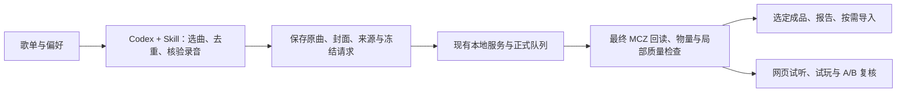

# 用 Codex 按歌单安排自动制谱 · Playlist tasks with Codex

**批量制谱更推荐交给 Codex，结合本仓库的 `malody-4k` Skill 执行。** 把歌单链接、喜欢的音乐人、数量和难度告诉 Codex，它可以筛选歌曲、核验录音、准备完整音源、提交本地任务并检查交付。比逐首在前端上传、设置和提交更方便。网页继续用于单曲操作、试听试玩、区域编辑和候选 A/B。

Skill 是让 Codex 操作现有本地服务的工作说明。它不安装新模型，不把推理搬到云端，也不代表网页增加了网易云歌单按钮。仓库没有附带个人 Codex 聊天或预先启用的定时任务。

## 开始前

1. 按 [README](../README.md#快速开始) 安装所需引擎和 Beat This，并启动本地制谱服务。
2. 在 Codex 中打开本项目，让它先读取 [`skills/malody-4k/SKILL.md`](../skills/malody-4k/SKILL.md)。可以直接使用下面的任务文本，无需先安装全局 Skill。
3. 提供歌单链接或本地曲目清单，以及数量、音乐人偏好、难度、密度目标、尝试预算和是否导入游戏。未确定的音源保留为待处理，不能用试听片段或相似曲目顶替。

网易云歌单用于确定选曲身份和元数据。完整音源可能需要使用本地文件或其他经过核实的公开来源；遇到失效链接、版本不符或不可取得的曲目，报告原因并按用户偏好处理。不会保证任意歌单都能自动取得全部原曲。

## 可复制的任务示例

```text
先读取 skills/malody-4k/SKILL.md，使用已经运行的本地制谱服务。

根据以下网易云歌单挑选 20 首，优先我指定的音乐人，并与已有成品去重：
<歌单链接与音乐人偏好>

使用高级制谱流程和 V32，生成键盘 4K Balanced Expert / Master。
Expert 平均 NPS 目标 9–12，Master 11–15；希望 Master 至少高 1 NPS，
同时检查活动段、短时峰值和单轨负担。这些数值是我的偏好，不是通用难度定义。
每首最多 3 个候选，失败也计入尝试预算；不要靠声学补音凑密度。

核对完整录音、作者和封面，保存源身份、实际参数、请求 ID 和断点。
默认清理已消费的中间文件。生成后回读最终 MCZ，保留旧版本，
只把选定成品写入交付清单。完成后给我成功、未达标和待核验的汇总。
```

需要导入时在任务中补充实际 Malody V `chart` 目录和导入要求；未授权时生成交付包即可。原曲／人声／伴奏输入也可按用户偏好选择，分轨并不保证每首更好。若希望隔一段时间继续检查长任务，可以明确要求 Codex 安排后续自动检查；需要所在环境支持相应能力，阅读 Skill 本身不会创建定时任务。

## 自动任务怎样落地

Codex 将一次请求拆成可持久化的批次文件，而不是让一条聊天承担全部状态：



建议把每批的歌曲身份、来源台账、请求清单、控制器状态、交付清单和质量摘要放在 `work/<batch>/`。正式交付放在独立的 `outputs/` 子目录。它们默认均不会被 Git 提交。

### 公共批量提交工具

[`tools/batch_generate.py`](../tools/batch_generate.py) 消费 Codex 已经准备好的高级项目请求。项目创建、元数据和声部准备由 Codex 按 [服务接口参考](../skills/malody-4k/references/service-api.md) 完成；工具不直接解析歌单或自动下载音乐。

每个条目代表一次正式生成请求，而不是完整的质量重试循环。Expert 和 Master 可以放在同一请求，也可根据输入策略拆开。请求示例：

```json
{
  "schema": 1,
  "service_url": "http://127.0.0.1:8765",
  "jobs": [
    {
      "key": "recording-001-attempt-01",
      "project_id": "<actual 32-character project id>",
      "payload": {
        "request_id": "<new frozen uuid4 hex>",
        "expected_revision": 2,
        "segment_ids": ["<actual segment id>"],
        "variants": ["balanced--expert", "balanced--master"],
        "source_id": "original",
        "settings": {"retain_debug_artifacts": false}
      }
    }
  ]
}
```

占位 ID、项目修订号和片段列表必须替换为实际 API 返回值；不要原样运行示例。保存为 `work/<batch>/requests.json` 后：

```powershell
.\.venv\Scripts\python.exe tools\batch_generate.py 'work\my-batch\requests.json' --check
.\.venv\Scripts\python.exe tools\batch_generate.py 'work\my-batch\requests.json'
```

工具在同目录保存 `state.json`，提交前写入完整意图，一次等待一个请求完成，保存回执和最新结果。中断后重跑同一命令，只跟踪已接受的批次，不重新生成。不能一边运行一边改请求文件；新候选应使用新的请求 ID、清单和状态文件，并由 Codex 维护总尝试预算。

失败、partial、取消或中断结果停止该控制器，等待 Codex 核对，不自动重试。服务重启后排队任务可能暂停，需要明确继续原队列。POST 响应丢失时，从同一部署的磁盘回执核对请求哈希；找不到可靠回执时停止，不盲目重复提交。服务运行在另一个本地克隆时使用 `--service-root` 指向它。

控制器完成只代表生成结束。Codex 仍需读取结果版本、独立导出候选、核对封面与作者，再按 [质量与交付说明](chart-quality.md) 检查、选包和导入。它不会自动采用候选或把未达标结果标记成合格。

## 文件和隐私

[存储策略](storage.md) 默认保留原曲、不可变版本、实际参数和摘要，消费后清理临时音轨和详细诊断。单曲异常才开调试重试。除明确发布的 [Demo](../demos/README.md) 外，个人歌单、音源链接台账、Cookie、登录资料、API 凭据和成品包保留本地。

“本地推理”描述制谱模型的运行位置。使用 Codex 时，提供给它的任务文本、元数据和工具结果仍会按 Codex 的配置处理；不要把密钥、Cookie 或无必要的完整诊断放进任务。

## English

**For playlist batches, prefer asking Codex to use the repository's `malody-4k` Skill to arrange automatic tasks.** It can select songs, verify recordings, prepare sources, submit the existing local queue, check candidates and deliver selected packages. The web studios remain useful for individual songs, listening, practice, editing and A/B review.

Open this project in Codex and explicitly ask it to read `skills/malody-4k/SKILL.md`; no global installation is required for that instruction. Supply playlist links, artist preferences, count, difficulty/NPS goals, attempt budget and import requirements. Playlist identity is distinct from obtaining a verified full recording. Missing or ambiguous sources stay unresolved. The repository does not ship a preconfigured Codex chat, scheduled job or web playlist button.

`tools/batch_generate.py` submits already prepared Advanced project requests using the schema above. `--check` validates without service calls. Normal execution writes intent before submission, waits serially and saves `state.json`. Rerun an unchanged manifest to follow accepted batches. Failed/partial requests stop; Codex handles candidate budgets and quality decisions. An uncertain POST is reconciled against a matching local service receipt, never blindly reposted. A new candidate needs a new request ID and state file.

Follow [service APIs](../skills/malody-4k/references/service-api.md), [quality/import](chart-quality.md) and [storage](storage.md) for preparation and delivery. Generation completion does not establish quality or adopt candidates. Future periodic checks require an explicit user request and scheduling support in the Codex environment. Local chart inference does not imply that information given to Codex stays local.
